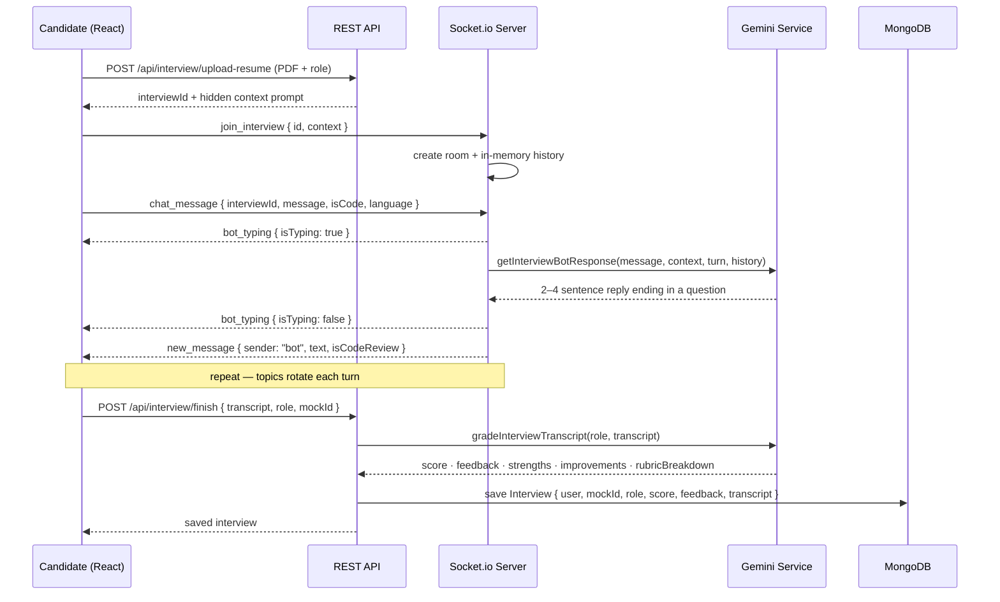
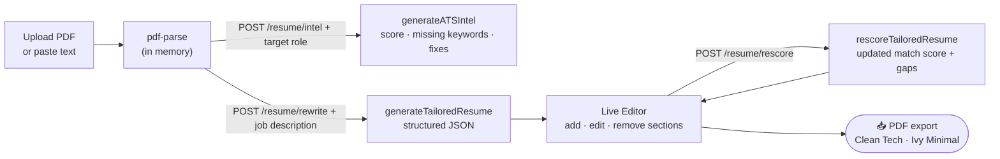
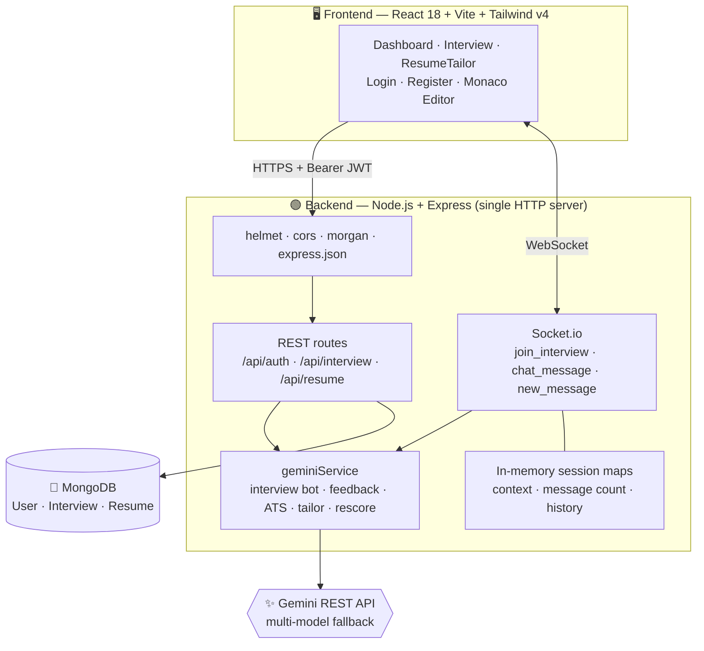

  <div align="center">

#  PrepForge
 
### *Forge your prep — a real-time AI interviewer with an ATS resume studio built in*
 
**Talk it through. Code it live. Get scored. Ship a sharper resume.**
 
[](https://react.dev)
[](https://vite.dev)
[](https://tailwindcss.com)
[](https://nodejs.org)
[](https://socket.io)
[](https://www.mongodb.com)
[](https://aistudio.google.com)
[](https://jwt.io)
 
**🌐 Live demo:** [prepforge-ai-seven.vercel.app](https://prepforge-ai-seven.vercel.app)
 
**status:** `v1.0` — working core, active roadmap ↓
 
</div>
---
 
## 📌 What is PrepForge?
 
**PrepForge** is a full-stack, **AI-powered interview preparation platform**. It puts two things job seekers usually juggle separately into one app:
 
1. **A real-time AI technical interviewer** — it chats with you over WebSockets, reads your resume context, asks CS-core and DSA questions, reviews the code you submit from a live editor, and ends with a scored rubric.
2. **An ATS Resume Studio** — upload a resume, paste a job description, and get a gap analysis, a full AI-tailored rewrite, a live editor, an instant re-score, and a PDF export.
> **The problem it solves:** candidates practise DSA in one place, never rehearse CS fundamentals or resume walk-throughs, and tweak resumes blindly hoping an ATS approves. PrepForge closes the loop — *practise → get structured feedback → fix the resume → repeat* — and stores every session so progress is something you can see, not guess.
 
---
 
## ✨ Feature Highlights
 
| | Feature | Where it lives |
|---|---|---|
| ⚡ | **Real-time interviewer** — Socket.io rooms per interview, live "bot is typing" state, instant replies | `services/socketService.js` |
| 🧠 | **Structured interview curriculum** — resume architecture → OS / DBMS / Networks → DSA & SQL, enforced by the system prompt | `services/geminiService.js` |
| 🚫 | **No-repeat questions** — full session history is fed back into every prompt, with an explicit rule never to re-ask a topic | `getInterviewBotResponse` |
| 💻 | **Live code review** — code is sent as `[CODE_SUBMISSION: <language>]`; the AI checks correctness, edge cases, and exact Time/Space complexity | `socketService.js`, `geminiService.js` |
| 🎙️ | **Voice mode** — spoken answers via Web Speech Recognition, replies via Text-to-Speech | `frontend/src/pages/Interview` |
| ✍️ | **Monaco editor** — syntax highlighting for JavaScript, Python, C++, Java, Go | `frontend/src/components` |
| 📝 | **Rubric scorecards** — overall score, written feedback, strengths, improvements, and 4-axis breakdown | `generateInterviewFeedback` |
| 📄 | **ATS diagnostics** — match score, missing keywords, actionable improvements against a target role | `generateATSIntel` |
| 🪄 | **Job-tailored resume rewrite** — structured JSON output (contact, summary, categorized skills, experience, projects, education, certifications) using the Google XYZ bullet formula | `generateTailoredResume` |
| 🔁 | **Live ATS re-scorer** — score recomputes from the edited resume data | `rescoreTailoredResume` |
| 🎨 | **Template switcher & PDF export** — *Clean Tech* / *Ivy Minimal*, exported via `html2canvas` + `jsPDF` or browser print | `frontend/src/pages/ResumeTailor` |
| 🛡️ | **Resilient AI layer** — 5-model fallback chain, per-call timeouts, JSON mode, and graceful fallback responses | `callGemini` |
| 🔐 | **JWT auth** — bcrypt-hashed passwords, password never returned by default, 30-day tokens, protected REST routes | `controllers/authController.js`, `middlewares/authMiddleware.js` |
| 🗂️ | **Private PDF handling** — resumes are PDF-only, capped at 5 MB, parsed in memory and never written to disk | Multer `memoryStorage` in `routes/` |
 
---
 
## 🔄 The Interview Lifecycle
 

 
### 🎯 What the interviewer actually asks
 
| Turn | Focus | Examples |
|---|---|---|
| **1** | Resume & system architecture | project tradeoffs from your resume context |
| **2–3** | CS core fundamentals | OS (paging, deadlocks, scheduling), DBMS (B-Trees vs LSM, ACID, isolation levels), Networks (TCP vs UDP, TLS, DNS, L4 vs L7) |
| **4+** | DSA & SQL in the live editor | trees, graphs/topo-sort, DP, sliding window, binary search, monotonic stack, heaps, window-function SQL |
 
Code submissions get a verdict on correctness and edge cases, an exact Big-O statement, 2–3 sentences of feedback, then either an optimization challenge or a topic switch.
 
> **Resume context:** `POST /api/interview/upload-resume` parses the PDF in memory, keeps the first ~2,000 characters, and wraps them with the target role into a hidden context prompt that steers the opening questions.
 
---
 
## 📄 The Resume Studio Pipeline
 

 
The tailored output is **structured JSON**, not a blob of text — that's what lets the editor render each section, the re-scorer audit the edited data, and the templates restyle the same content instantly.
 
---
 
## 🏗️ Architecture
 

 
**Why both REST and WebSockets?** Account, history, and resume operations are request/response — REST fits. The interview is a live conversation with typing indicators and instant turn-taking — that's what Socket.io is for. Both share one `http.Server`.
 
---
 
## 🛡️ The Resilient AI Layer
 
Every AI feature goes through one function, `callGemini`:
 
```
for each model in MODEL_FALLBACK_LIST (priority order):
    POST generateContent  ──►  timeout via AbortController
    non-200 / empty text / network error  ──►  log + try next model
all models failed  ──►  throw → caller returns a graceful fallback
```
 
| Concern | How it's handled |
|---|---|
| **Model outages / rate limits** | ordered chain of 5 fast Flash / Flash-Lite models; first healthy one wins |
| **Hung requests** | per-call timeouts — 18 s interview, 15 s re-score, 25 s default, 30 s resume tailoring |
| **Malformed JSON** | `responseMimeType: application/json` plus `extractJsonFromText`, which strips markdown fences |
| **Latency** | tight `maxOutputTokens` per feature; interviewer replies capped at 2–4 sentences |
| **Total failure** | the interviewer falls back to a curated question pool, so a session never dead-ends |
 
---
 
## 📡 API Reference
 
### REST
 
| Method | Endpoint | Auth | Purpose |
|---|---|---|---|
| `POST` | `/api/auth/register` | 🌐 public | create a candidate account |
| `POST` | `/api/auth/login` | 🌐 public | authenticate → JWT |
| `GET` | `/api/auth/me` | 🔒 JWT | current logged-in user |
| `POST` | `/api/interview/upload-resume` | 🔒 JWT | multipart `resume` (PDF ≤ 5 MB) + `role` → `{ interviewId, context }` to start a session |
| `POST` | `/api/interview/finish` | 🔒 JWT | `{ transcript, role, mockId }` → AI grades it, saves the interview, returns it |
| `GET` | `/api/interview/history` | 🔒 JWT | the user's past interviews, newest first |
| `POST` | `/api/resume/intel` | 🔒 JWT | multipart `resume` (PDF) + `role` → ATS score, missing keywords, improvements |
| `POST` | `/api/resume/rewrite` | 🔒 JWT | `jobDescription` + resume PDF *or* `rawResumeText` → tailored structured resume |
| `POST` | `/api/resume/rescore` | 🔒 JWT | JSON `{ resumeData, jobDescription }` → updated match score and gaps |
 
### WebSocket events
 
| Direction | Event | Payload |
|---|---|---|
| client → server | `join_interview` | `{ id, context }` — joins the room, stores resume context |
| client → server | `chat_message` | `{ interviewId, message, isCode, language }` |
| server → client | `bot_typing` | `{ isTyping: boolean }` |
| server → client | `new_message` | `{ sender: "bot", text, isCodeReview }` |
 
---
 
## 🚀 Getting Started
 
### Prerequisites
- **Node.js 18+** (uses the built-in `fetch`)
- **MongoDB** — local, or a free [Atlas](https://www.mongodb.com/atlas) cluster
- A **[Google Gemini API key](https://aistudio.google.com/)**
### 1 · Clone
 
```bash
git clone https://github.com/kotawalataha52/PrepForge.git
cd PrepForge
```
 
### 2 · Configure & run the backend
 
```bash
cd backend
npm install
```
 
Create `backend/.env`:
 
```env
PORT=5000
MONGO_URI=mongodb://localhost:27017/prepforge
# or Atlas: mongodb+srv://<username>:<password>@cluster.mongodb.net/prepforge?retryWrites=true&w=majority
JWT_SECRET=<a-strong-secret-at-least-32-chars>
JWT_EXPIRE=30d            # optional, defaults to 30d
GEMINI_API_KEY=<your-gemini-api-key>
```
 
```bash
npm run dev      # nodemon
# or
npm start
```
 
API + WebSocket server: **http://localhost:5000** — `GET /` returns `PrepForge API Running`.
 
### 3 · Run the frontend
 
```bash
cd frontend
npm install
npm run dev
```
 
Open **http://localhost:5173**.
 
### 4 · Try the full loop 🎮
1. **Register** and log in
2. Start an **Interview** — upload your resume PDF, pick a target role, answer the opening question, then a CS-core one
3. When the DSA problem arrives, solve it in the **Monaco editor** and submit — watch for the complexity review
4. **Finish** and read your scorecard; check history on the **Dashboard**
5. Open **Resume Tailor** → upload your PDF → paste a job description
6. Run the **AI rewrite**, edit bullets live, and watch the ATS score update
7. Choose a template → **Export PDF** 📥
---
 
## 📂 Project Structure
 
```
PrepForge/
├── backend/                          # Node.js · Express · Socket.io · MongoDB
│   ├── config/db.js                  # MongoDB connection
│   ├── controllers/                  # Auth, Interview, Resume
│   ├── middlewares/                  # authMiddleware (JWT `protect`)
│   ├── models/                       # User, Interview (Mongoose)
│   ├── routes/                       # authRoutes, interviewRoutes, resumeRoutes (+ Multer config)
│   ├── services/
│   │   ├── geminiService.js          # callGemini + interview bot, feedback, ATS, tailor, rescore
│   │   └── socketService.js          # Socket.io rooms + in-memory session state
│   └── server.js                     # Express + HTTP server + Socket.io bootstrap
└── frontend/                         # React 18 + Vite 8 + Tailwind v4
    ├── public/                       # favicon, logo
    └── src/
        ├── components/               # Logo, Navbar, Sidebar, Monaco wrapper
        ├── context/                  # auth & app state
        ├── pages/                    # Dashboard, Interview, ResumeTailor, Login, Register
        ├── utils/                    # Axios client, helpers
        ├── App.jsx                   # routing + protected layout
        └── main.jsx
```
 
---
 
## 🗄️ Data Model
 
| Collection | Fields | Notes |
|---|---|---|
| `users` | `name`, `email`, `password`, `createdAt` | `email` UNIQUE + format-validated; `password` min 6 chars, bcrypt-hashed (10 salt rounds) in a `pre('save')` hook, `select: false` so it never leaks in queries; `matchPassword()` instance method |
| `interviews` | `user` → User, `mockId`, `role`, `score`, `feedback`, `transcript[]`, timestamps | `transcript` is an embedded array of `{ sender: 'user' \| 'bot', text }`; `role` defaults to *Software Engineer* |
 
> Resume PDFs and tailored resumes are processed in memory and returned to the client — they are not stored in MongoDB today.
 
---
 
## 🔐 Security Model
 
- **bcrypt** hashing with per-user salts; passwords excluded from queries by default
- **JWT** `protect` middleware guarding every REST route except register/login; tokens last 30 days by default (`JWT_EXPIRE`)
- **helmet** security headers, **cors** enabled, **morgan** request logging
- **Multer memory storage** — PDF-only filter, 5 MB cap, nothing written to disk
- **Secrets in `.env`** — Gemini key, JWT secret, and DB URI stay out of source control
---
 
## 🧪 Engineering Notes
 
- **Why call Gemini over plain REST?** One `fetch` wrapper means no SDK lock-in, full control of timeouts via `AbortController`, and a clean place to add the model fallback chain.
- **Why a fallback chain instead of one model?** Free-tier models rate-limit and time out unpredictably. Trying the next model turns a failed request into a slightly slower success.
- **Why feed the whole history back each turn?** Gemini calls are stateless. Replaying the transcript is what makes "never repeat a topic" enforceable and lets the interviewer reference earlier answers.
- **Why JSON mode + a fence-stripper?** Scorecards and resumes are consumed by code, not read by humans — a response that isn't parseable JSON is a bug, so the layer defends against it twice.
- **Why structured resume JSON?** One source of truth drives the editor, the re-scorer, both templates, and the PDF — edit once, everything updates.
---
 
## 🗺️ Roadmap & Known Limitations
 
*Honest engineering — v1 is a working core with clear edges:*
 
- [ ] **Authenticate the WebSocket handshake** — verify the JWT on `connection` and tie each room to its owner; restrict Socket.io CORS from `*` to the deployed frontend origin
- [ ] **Durable session state** — live interview context, counters, and history currently sit in in-memory `Map`s (lost on restart, single-instance only, never evicted); move to Redis or MongoDB with a TTL
- [ ] **Persist the full scorecard** — the AI returns strengths, improvements, and a 4-axis `rubricBreakdown`, but the `Interview` schema stores only `score`, `feedback`, and `transcript`
- [ ] **Fail loudly, not optimistically** — when every model fails, scoring helpers currently return default scores; surface an error / "couldn't grade" state instead
- [ ] **Unbiased ATS scoring** — remove the hard-coded score ranges from prompts and ground the score in measurable keyword overlap
- [ ] **Code execution sandbox** — run submissions against test cases instead of relying on AI judgment alone
- [ ] **Rate limiting** on auth and AI routes to protect Gemini quota
- [ ] **Cleanup** — remove the debug request logger from `server.js`, add an input-validation layer
- [ ] **Require `JWT_SECRET` at startup** — `authController` falls back to a hard-coded `'secret'` if the env var is missing; fail fast instead
- [ ] **Richer resume context** — the interviewer keeps only the first ~2,000 characters of the resume, so later projects may never come up
- [ ] **Save tailored resumes** — results currently live only in the client; persist versions per job
- [ ] **Upload error handling** — a non-PDF upload currently surfaces as a generic server error instead of a clean `400`
- [ ] **Test suite** — unit tests for the AI layer (mock `fetch`), integration tests for the REST API
---
 
## 🛠️ Tech Stack
 
| Layer | Technology |
|---|---|
| Frontend | React 18, Vite 8, Tailwind CSS v4, Framer Motion, Monaco Editor, Lucide React |
| Realtime | Socket.io |
| Backend | Node.js, Express, Multer, `pdf-parse`, `bcrypt`, `jsonwebtoken`, `helmet`, `cors`, `morgan` |
| Database | MongoDB + Mongoose |
| AI | Google Gemini via REST (`generateContent`, JSON mode, multi-model fallback) |
| PDF | `jsPDF`, `html2canvas` |
| Deployment | Vercel (frontend) |
 
---
 
## 👤 Author
 
**Taha Kotawala** — built end-to-end, from the real-time AI interviewer to the resume studio.
 
<div align="center">
⭐ *If a WebSocket AI interviewer, a resilient multi-model AI layer, and a live ATS resume studio in one codebase sounds useful, star the repo.*
 
</div>
